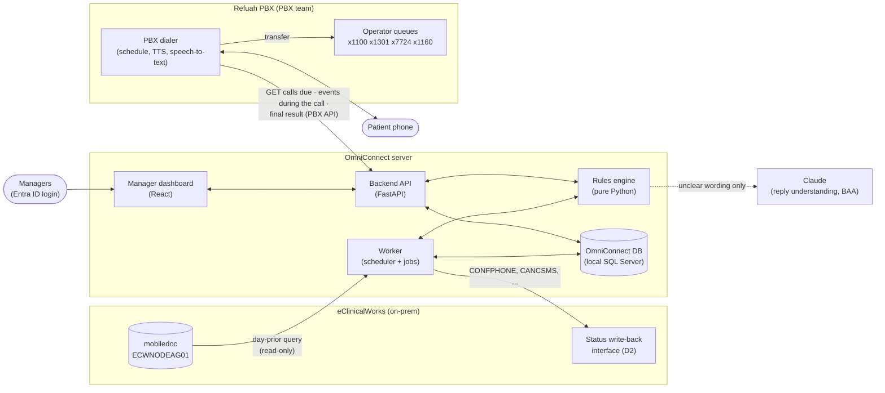
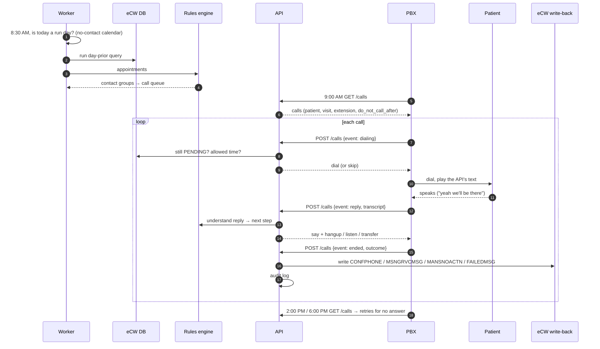
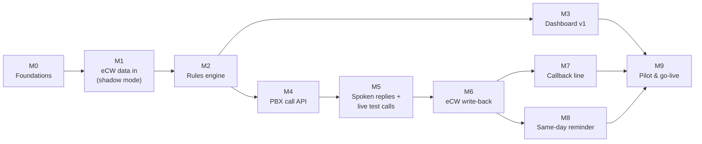

# OmniConnect: Development Plan

**Component:** Phase 3, Automated Appointment Confirmations & Reminders
**Owner:** ygarbuz, Refuah Health Center
**Status:** v1.0 draft, 2026-11-10
**Related:** [`db/ecw/PLAN.md`](../db/ecw/PLAN.md) (eCW query plan) · [`GETTING_STARTED.md`](GETTING_STARTED.md) (beginner guide to Git, Python and React) · [`PBX_INTEGRATION_API.md`](PBX_INTEGRATION_API.md) (API contract for the PBX team)
**Updated:** 2026-11-15: calls run on Refuah's PBX (PBX team) through OmniConnect's API; spoken replies; cancel → transfer to an operator.

---

## Contents

1. [What we are building](#1-what-we-are-building)
2. [Technology choices](#2-technology-choices)
3. [Architecture](#3-architecture)
4. [Repository layout](#4-repository-layout)
5. [OmniConnect database](#5-omniconnect-database)
6. [Rules engine: requirement → code](#6-rules-engine-requirement--code)
7. [Milestones](#7-milestones)
8. [Decisions needed](#8-decisions-needed)
9. [Security & HIPAA rules for development](#9-security--hipaa-rules-for-development)
10. [Testing strategy](#10-testing-strategy)
11. [Risks](#11-risks)

---

## 1. What we are building

A system that, every day:

1. **Reads** tomorrow's PENDING appointments from eCW (the query in `db/ecw/`).
2. **Decides** who to contact and what to say: family grouping, Spanish, arrival times, no-show notice, and the Shabbat/holiday no-contact rule.
3. **Contacts** patients by call and text, with voicemail and retries.
4. **Understands** the answer (confirm, cancel or reschedule) and transfers to reception when needed.
5. **Writes the result back** to eCW (CONFPHONE, CONFSMS, CANCPHONE, ...).
6. **Shows everything** to managers on a dashboard, with a full audit trail.

The same platform later carries Phases 1, 2, 4 and 5 (AI receptionist, scheduling, front-desk assistant, campaigns). Phase 3 is built first because it is mostly **fixed rules**, has clear value, and needs no AI.

**Guiding principle:** the system never contacts a real patient until a step has been tested, reviewed and switched on deliberately (see [allowlist mode](#allowlist-mode)).

---

## 2. Technology choices

**Your proposal of GitHub, Python and React is a good fit. Keep it.** I'd change two things from the first-session recommendation, because we now know Refuah runs SQL Server on-premises:

| Layer | Choice | Why |
|---|---|---|
| Source control | **GitHub** (private repository) | Industry standard, free for private repos, built-in reviews (pull requests) and automation (Actions). |
| Backend | **Python 3.13 + FastAPI** | Easy to read and learn; best ecosystem for the AI phases later; FastAPI generates API docs automatically. |
| Python tooling | **uv** (installs Python and packages), **Ruff** (formatting/lint), **pytest** (tests) | One fast tool instead of pip, venv and pyenv; very beginner-friendly. |
| Database access | **SQLAlchemy 2 + pyodbc + Microsoft ODBC Driver 18** | The standard way for Python to talk to SQL Server. |
| OmniConnect's own database | **SQL Server, in the local database you already use** *(changed from PostgreSQL)* | It already holds `vw_TestPatients` and `omni_no_contact_days`; your DBAs already back up, secure and monitor SQL Server; you already know SSMS. |
| Background jobs | **APScheduler** inside a separate "worker" process | Runs the 9:00 AM job, retries and same-day reminders. No extra servers (no Redis/Celery) needed at this size. |
| Frontend (dashboard) | **React + TypeScript + Vite** | React is the most widely used UI library; TypeScript catches mistakes as you type; Vite is the standard fast starter. |
| UI components | **MUI (Material UI) + MUI X Data Grid** | Ready-made, good-looking tables, search, filters and CSV export, so you don't design from scratch. |
| Data fetching in React | **TanStack Query** | Handles loading, refreshing and errors for live dashboard counts. |
| Staff login | **Microsoft Entra ID** (MSAL) | Staff use their Refuah Microsoft account; roles come from AD groups. |
| Calls | **Refuah's PBX, built by the PBX team** *(decided 2026-11-15, see [D1](#8-decisions-needed))* | The PBX runs the schedule, dials, plays the text, records the reply and transfers. OmniConnect provides the API it calls: [PBX_INTEGRATION_API.md](PBX_INTEGRATION_API.md). |
| Understanding spoken replies | **Word lists first, then Claude** (Opus 5.5 at low effort; Haiku 5.5 if speed requires it) | Free-form answers ("we'll be there") without forcing keypad choices. Anything unclear → transfer to an operator. Needs a BAA (D8). |
| Texts (SMS) | **Later, after voice:** provider to decide | Not needed for the first release. |
| Hosting | **On-premises Windows server** *(changed from Azure)*, unless IT prefers Azure | eCW, the local database and the PBX are all on-premises, so this is the simplest and safest network path. |

**Alternatives considered:**
- **C# / .NET + Blazor:** fits a Microsoft shop very well, but it's harder to learn than Python, and weaker for the AI phases. Choose it only if Refuah IT requires .NET.
- **Plain JavaScript instead of TypeScript:** a little easier on day one, but you'd lose the safety net. With an editor and Claude helping, TypeScript is worth it.
- **Low-code (Power Apps / Power Automate):** fine for simple forms, but not for call flows, retries and audit requirements at this level.

---

## 3. Architecture



### The pieces

| Piece | What it does | Runs as |
|---|---|---|
| **Worker** | At about 8:30 AM on run days it runs the eCW query, saves a snapshot, asks the rules engine for contact groups, and fills the **call queue** that the PBX pulls from. It also queues retries and writes statuses back to eCW. | Windows service #1 |
| **Rules engine** | Pure Python functions with **no database or network access** (apart from the optional Claude call for unclear replies). Easy to test: given appointments, it returns groups, message text, times and status codes; given a reply, it returns the next step of the conversation. | Library used by the worker and the API |
| **Backend API** | Serves the dashboard, and the **PBX API**: calls due, the pre-dial check, live conversation events, final results ([PBX_INTEGRATION_API.md](PBX_INTEGRATION_API.md)). | Windows service #2 |
| **Dashboard** | React app: search, live counts, visit timeline, at-risk list, export. | Static files served by the API or by IIS |
| **OmniConnect DB** | Snapshots, contact attempts, responses, status updates and the append-only audit log. | Your existing local SQL Server |

### Daily flow



---

## 4. Repository layout

One GitHub repository holds everything (a "monorepo"), so the query, the backend and the dashboard always change together.

```
OmniConnect/
├── README.md                  ← what the project is + how to run it
├── .gitignore                 ← files Git must never save (.env, data exports, ...)
├── .env.example               ← list of settings, with fake values
├── docs/
│   ├── DEVELOPMENT_PLAN.md    ← this file
│   ├── GETTING_STARTED.md     ← beginner guide
│   ├── PBX_INTEGRATION_API.md ← API contract shared with the PBX team
│   └── decisions/             ← one short note per big decision (D1, D2, ...)
├── db/
│   ├── ecw/                   ← eCW read queries (exists today)
│   └── omni/                  ← OmniConnect tables (created by migrations)
├── backend/
│   ├── pyproject.toml         ← Python dependencies (managed by uv)
│   ├── app/
│   │   ├── main.py            ← FastAPI app starts here
│   │   ├── config.py          ← reads settings from .env
│   │   ├── api/               ← HTTP endpoints: dashboard.py, pbx.py (the PBX API)
│   │   ├── ecw/               ← runs eCW queries, status write-back
│   │   ├── rules/             ← rules engine (pure functions)
│   │   ├── channels/          ← voice + SMS provider code
│   │   ├── worker/            ← scheduler and jobs
│   │   ├── db/                ← tables (SQLAlchemy models) + migrations (Alembic)
│   │   └── audit.py           ← one function every action calls
│   └── tests/                 ← pytest tests, mirrors app/
├── frontend/
│   ├── package.json           ← JavaScript dependencies
│   └── src/
│       ├── main.tsx           ← React starts here
│       ├── pages/             ← one file per screen (Today, Search, Visit, ...)
│       ├── components/        ← reusable pieces (StatusChip, Timeline, ...)
│       └── api/               ← functions that call the backend
└── .github/
    ├── workflows/ci.yml       ← runs tests on every push
    └── pull_request_template.md
```

---

## 5. OmniConnect database

The tables live in the local SQL Server database, under a schema named `omni`. They are created by **Alembic migrations**, which are versioned scripts in Git, so every environment has the same tables.

| Table | One row per | Key columns |
|---|---|---|
| `omni.run` | daily job run | run date, target dates, started/finished, row count, errors |
| `omni.appointment_snapshot` | appointment per run | eCW `encounterID`, patient, provider, site, time, flags from the query |
| `omni.contact_group` | call/text unit (patient or family) | phone used, language, message text, channel plan |
| `omni.contact_group_member` | appointment in a group | group ↔ appointment |
| `omni.contact_attempt` | each dial attempt (`attempt_id`) | call, attempt number, state (queued → reserved by PBX → dialing → closed), `do_not_call_after`, result from the PBX (completed, transferred, voicemail, no answer, busy, failed, not dialed) |
| `omni.call_event` | each conversation step | attempt, sequence, event (answered, reply, no_input, voicemail), transcript, how it was understood, the API's answer (say, action, transfer_to). Lets the PBX's retries be answered the same way twice. |
| `omni.patient_response` | each understood reply | outcome (confirm, cancel, reschedule, unclear), method (word list or Claude) |
| `omni.transfer` | each queue transfer | extension, wait-time estimate given, actual wait, answering agent |
| `omni.status_update` | each eCW write-back | appointment, old → new code, sent at, confirmed at, error |
| `omni.audit_event` | everything that happens | when, who (system or staff user), what, which appointment. **Insert-only**: the app account has no UPDATE/DELETE rights on it |
| `omni.setting` | adjustable value | retry times, morning start, quiet hours, allowlist mode on/off |
| `dbo.omni_no_contact_days` | holiday date | **exists already** (`03_no_contact_calendar.sql`) |

**Rule:** we never copy more PHI than the query already returns, and we never store it anywhere except this database (not in logs, files or Git).

---

## 6. Rules engine: requirement → code

Every rule in the requirements becomes one small, tested Python function in `backend/app/rules/`. This table is the checklist for M2.

| Requirement | Function | Notes |
|---|---|---|
| Same patient, provider + resource same day → one call | `group_contacts()` | also merges family members |
| Family members same day → one call/text | `group_contacts()` | uses `family_group_key` from the query |
| Message: name, provider, time, site + address, visit type (not for new patients) | `build_message(group, lang)` | English + Spanish templates in files, not code |
| Spanish | `choose_language()` | from the query's Spanish flag (source still TBD) |
| Late alert: arrive 10 min (Peds) / 15 min (Adults) early | `arrival_time()` | the query already computes the offset; the function double-checks |
| New-patient earlier arrival | `arrival_time()` | waiting on where the note lives |
| No-show notice on voicemail (NP, Adult Well, Specialty Consult) | `needs_no_show_notice()` | voicemail only |
| No contact Fri/eve 12:00 PM → next regular morning | `is_contact_allowed(at)`, `next_allowed_time(at)` | must match the SQL logic exactly; shared test cases |
| Voicemail, then afternoon + evening retries | `retry_schedule()` | times in `omni.setting` |
| Understand a spoken reply: confirm / cancel / reschedule / unclear | `understand_reply(transcript, lang)` | word lists (English + Spanish) first; Claude only when the lists don't settle it; **anything not clearly one of the options → unclear**, never guess |
| Conversation: what to say and do after each event | `next_step(state, event)` | returns `say` + `listen` / `hangup` / `transfer`, as in [PBX_INTEGRATION_API.md §4.2](PBX_INTEGRATION_API.md#42-post-calls-report-what-happened) |
| Cancel → repeat it back ("You'd like to cancel ... is that right?") → **transfer to an operator; the visit is NOT updated** *(decided 2026-11-15)* | `next_step()` | status stays as eCW has it; the operator cancels in eCW if needed |
| Reschedule → ask cancel-now or keep-while-searching → transfer | `next_step()` | routing group from the query |
| Unclear reply, or silence twice → transfer to an operator | `next_step()` | |
| Transfer: Primary Care x1100, Specialty x1301, Hillcrest x7724, Wilson x1160 | `transfer_extension()` | also sent as the PBX's fallback extension |
| PBX result → eCW code: confirmed → CONFPHONE, voicemail → MSNGRVCMSG, transferred → MANSNOACTN, unreachable/failed → FAILEDMSG | `status_code(outcome, channel)` | outbound calls no longer produce CANCPHONE; it stays for the callback line (M7) |
| **Write to eCW only CONFPHONE for now** *(decided 2026-11-15)*: the other codes are recorded in OmniConnect and shown on the dashboard, and written to eCW only after approval | `should_write_to_ecw(code)` | controlled by the setting `ecw_writeback_codes` in `omni.setting` (starts as `CONFPHONE`), so more codes can be switched on without a code change |
| **Write only if the visit is still PENDING:** read the current eCW status first; if staff changed it (for example an operator cancelled during a transfer), keep their change and only log the call | `should_write_to_ecw(code, current_status)` | protects operator and front-desk changes from being overwritten |
| Transferred patient wanted to cancel but hung up in the queue | `needs_follow_up()` | shown on the dashboard as "wanted to cancel, not handled" |
| Same-day reminder: change status **only** on explicit confirm/cancel | `status_code(..., same_day=True)` | returns "no change" for anything else |
| Reply on one channel isn't overridden by the other | `resolve_outcome(responses)` | first explicit answer wins; later "no answer" never overrides it |

---

## 7. Milestones

Each milestone ends with something you can **see working**. The calendar is set less by coding than by decisions and approvals (D1–D6), so start those early.



Size: **S** about 1 week · **M** about 2–3 weeks · **L** about 4+ weeks, for one developer learning as they go with AI help.

### M0: Foundations (S)
**Goal:** tools installed, empty but working project on GitHub.
- Install Git, uv/Python, ODBC driver, VS Code extensions ([GETTING_STARTED.md](GETTING_STARTED.md)).
- Create the private GitHub repository; push the existing `db/` and `docs/` folders.
- Create the `backend/` skeleton: FastAPI with a `/health` endpoint that also checks it can reach the local SQL Server.
- Create the `frontend/` skeleton: a Vite + React page showing "OmniConnect" and the `/health` result.
- Add GitHub Actions CI: run Ruff and pytest on every push.

**Done when:** a teammate can clone the repo, follow the README, and see the page in their browser.

### M1: eCW data in, shadow mode (M)
**Goal:** the system pulls the real list every day, **without contacting anyone**.
- Finish the query TODO in `db/ecw/PLAN.md`; turn it into a stored procedure with `@target_date`.
- Read-only service account for the app (D4).
- Worker job: 9:00 AM on run days → run the procedure → save to `omni.run` + `omni.appointment_snapshot`.
- Dashboard page **"Tomorrow's list"**: what the system *would* contact, with counts per site/provider.

**Done when:** for 5 working days, the list matches the eCW Resource Schedule (Step 5 of the query plan), checked by front-desk staff.

### M2: Rules engine (M)
**Goal:** every rule in section 6 implemented and tested, still without contacting anyone.
- Functions + pytest tests built from the requirement tables (one test per row).
- English and Spanish message templates, reviewed by Refuah (and a Spanish speaker).
- Dashboard: **message preview** for each group ("this is exactly what the patient would hear/read").

**Done when:** all tests pass, and Refuah signs off on 20 sample previews, including a family, a Spanish patient, a late-alert patient and a Friday run.

### M3: Manager dashboard v1 (M–L)
**Goal:** the dashboard from the requirements, working on shadow data.
- Entra ID login; roles Viewer / Manager / Admin from AD groups (D5).
- Search by name, MRN, phone, provider, site, date.
- Live counts: confirmed / pending / canceled / unreached, by provider and site.
- Visit timeline (audit trail per appointment).
- At-risk list: unconfirmed high-priority visits approaching 9:00 PM.
- CSV/Excel export (logged in the audit trail).

**Done when:** managers can use it on shadow data and give feedback.

### M4: PBX call API (M), **can start now, in parallel with M1–M3**
**Goal:** the PBX endpoint (`/api/pbx/v1/calls`, GET + POST) working on a test server, so the PBX team can build against it.
- Agree the contract with the PBX team: [PBX_INTEGRATION_API.md](PBX_INTEGRATION_API.md) (v0.1 draft sent 2026-11-15; their answers to §10 may change it).
- Build it with **fake patients first**: `GET /calls` (calls due) and `POST /calls` (events: `dialing`, `answered`, `voicemail`, `reply`, `no_input`, `hangup_by_patient`, `ended`), with the required fields checked per event.
- API key + IP allowlist; requests and answers written to `omni.call_event` and the audit log.
- The conversation (`next_step()`) with **word lists only** to start: confirm → hang up, cancel → repeat back → transfer, reschedule → question → transfer, unclear or silence twice → transfer.
- **Fake PBX script:** a small Python script that plays the PBX's part, so every scenario in §5 of the spec can be tested without a phone.
- <a id="allowlist-mode"></a>**Allowlist mode:** `GET /calls` can only return numbers on a test list until an Admin switches it off in `omni.setting`. This switch is checked in the code that builds the list, so nothing can bypass it.
- Test server reachable from the PBX over HTTPS (D7).

**Done when:** the fake PBX script passes every scenario, and the PBX team completes a test call against the test server.

### M5: Spoken replies and live test calls (M–L)
**Goal:** free-form answers understood, and real calls to staff test phones.
- Claude added to `understand_reply()` for replies the word lists don't settle (BAA, D8). Measure the response time: the PBX waits at most about 4 seconds.
- **A test set of about 100 made-up replies** (English and Spanish) with the correct answer for each. Run it after every change; the result must not get worse.
- Voicemail text, including the no-show notice where it applies; English and Spanish wording reviewed by Refuah.
- Retries: no-answer and busy calls are offered again at the afternoon and evening pulls; the Shabbat/holiday rule is applied through `do_not_call_after` and the `dialing` event.
- Transfers carry a `transfer_note` for the operator if the PBX supports it; transfer results (wait time, abandoned) are shown on the dashboard.

**Done when:** a full scripted test day (around 30 scenarios) passes on staff test phones, including the fallback rule (API stopped mid-call).

### Later: SMS
Two-way texts, after voice is live: provider with a BAA, replies, delivery receipts, opt-out (STOP). **Open question:** a text can't be transferred, so what should happen when a patient texts "cancel"? Options: cancel it (CANCSMS), or reply asking them to call and flag it for staff.

### M6: eCW status write-back (M, depends on D2)
**Goal:** outcomes update eCW automatically.
- Implement the interface chosen in D2. Never write directly into eCW tables.
- Read the status back after writing to confirm it took; show failures on the dashboard for staff to fix manually.

**Done when:** in the eCW test environment, **CONFPHONE** updates correctly, and only on visits that are still PENDING. The other codes (MSNGRVCMSG, MANSNOACTN, FAILEDMSG) follow later, after approval, by adding them to `ecw_writeback_codes`.

### M7: Inbound callback line (M)
**Goal:** patients who call back can confirm or cancel.
- Main-menu option on the PBX → OmniConnect line.
- Identity check (method TBD, for example date of birth + appointment date).
- Confirm/cancel → CONFPHONE / CANCPHONE.

### M8: Same-day reminder (S–M)
**Goal:** a courtesy reminder 1.5 hours before, for all statuses.
- Same query, all statuses, today's date; quiet-hours rule for early appointments.
- Status changes only on an explicit confirm or cancel.

### M9: Pilot & go-live (M)
**Goal:** safely switch on for real patients.
- Install on the server as Windows services; HTTPS; backups; monitoring and alert emails when a job fails.
- Runbook: "what to do if the 9:00 AM job fails", "how to pause all contact".
- **Pilot:** one site and one department for 2 weeks, with allowlist mode off only for them.
- Compare confirmation and no-show rates against the previous period; fix issues; roll out site by site.

**Done when:** all four sites are live, and managers use the dashboard daily.

---

## 8. Decisions needed

| # | Decision | Needed by | Who |
|---|---|---|---|
| D1 | ✅ **Decided 2026-11-15:** calls run on **Refuah's PBX, built by the PBX team**, using OmniConnect's API. Still open: the PBX team's answers to the questions in [PBX_INTEGRATION_API.md §10](PBX_INTEGRATION_API.md#10-questions-for-the-pbx-team), mainly calling the API mid-call (Q2) and speech-to-text (Q3). SMS provider decided later. | Answers before M4 ends | PBX team |
| D2 | **Status write-back to eCW:** eCW API, HL7 SIU, or another eCW-supported method. Note: the codes (MSNGRVCMSG, ...) look like eCW Messenger's codes. If Refuah uses or used eCW Messenger, ask eCW how Messenger writes them; the same interface may be available. | Start of M6 (ask now; eCW can be slow) | IT + eCW |
| D3 | **BAAs** signed with the call/SMS provider (and any AI provider later). | Before any real patient data reaches them | Compliance |
| D4 | **Service accounts:** read-only on eCW, read/write on the `omni` schema. | Start of M1 | DBA |
| D5 | **Entra ID app registration** and the AD groups for dashboard roles. | Start of M3 | IT |
| D6 | **Is GitHub approved** for Refuah code? Create a Refuah GitHub organization (preferred over a personal account). Alternative: Azure DevOps. | Start of M0 | IT |
| D7 | **Hosting:** which server, and who patches and backs it up? On-prem or Azure? **A test server the PBX can reach over HTTPS is now needed for M4.** | Start of M4 | IT |
| D8 | **BAAs for patient speech:** the PBX's speech-to-text engine (if it's a cloud service) and Claude for understanding replies. Claude may be available through Refuah's Microsoft agreement; confirm. | Before real calls (M5) | Compliance |
| D9 | **Recording:** are calls recorded? Do patients need to be told? Retention for recordings and transcripts. | Before real calls (M5) | Compliance |

Write each answer as a short note in `docs/decisions/`, so the reasoning is saved.

---

## 9. Security & HIPAA rules for development

These apply from day one, including while you're learning.

1. **No PHI in Git, ever.** No real names, phones, MRNs, query results, screenshots or exports in commits. `.gitignore` blocks `*.csv`, `*.xlsx`, `exports/` and `.env`. If PHI is committed by mistake, **tell IT/compliance right away**; deleting it in a new commit is not enough, because Git keeps the history.
2. **Secrets live in `.env` only:** passwords, API keys and connection strings. `.env` is never committed; `.env.example` shows the names with fake values.
3. **Test with fake data.** Unit tests use made-up patients ("Test Patient", 555-0100 numbers). Real data is used only in the shadow environment on the server.
4. **Least privilege.** The app reads eCW through a read-only account; the dashboard shows each role only what it needs.
5. **Logs have no PHI.** Log appointment IDs, not names or phones.
6. **Audit everything:** every contact, response, status change, staff view of a patient timeline, and export.
7. **Private repo, protected `main` branch.** Changes go in through pull requests, and GitHub's secret scanning is turned on.

---

## 10. Testing strategy

| Level | What | Tool | When |
|---|---|---|---|
| Unit tests | Every rules-engine function, using cases from the requirement tables | pytest | Every push (CI) |
| Query tests | Shadow runs compared with the eCW schedule | SSMS + dashboard | M1, then weekly |
| API tests | Endpoints and webhooks with fake payloads | pytest + FastAPI test client | Every push |
| Frontend tests | Key screens render and filter correctly | Vitest + Testing Library | Every push (added in M3) |
| Scenario tests | Scripted test day on staff phones: family, Spanish, voicemail, retries, Friday, transfer, callback | Manual checklist | M4–M8 |
| Pilot | Real patients, one site/department | Dashboard metrics | M9 |

---

## 11. Risks

| Risk | Impact | Mitigation |
|---|---|---|
| eCW write-back not available, or slow to approve | Statuses must be updated by hand | Ask eCW now (D2); meanwhile the dashboard gives staff a "to update" list |
| PBX can't accept transfers from the provider | Reschedule flow breaks | Decide D1 with telecom early; test a transfer in M5 before building the rest |
| Linked-server query is slow | 9:00 AM job runs late | `OPENQUERY` / stored procedure (query TODO); time it in M1 |
| Wrong patient contacted (bad phone, stale status) | Patient trust, HIPAA | Re-check status before each contact; allowlist mode; pilot first |
| No-contact rule differs between SQL and Python | Calls on Shabbat | Shared test cases for both; one calendar table |
| Learning curve (Git/React new) | Slower start | M0 and M1 are small and safe; follow GETTING_STARTED.md; ask Claude to explain and review |
| One developer | Single point of knowledge | Docs, decision notes, tests and a README kept up to date |
