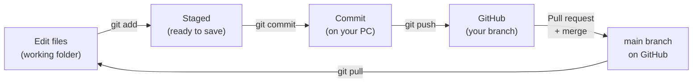
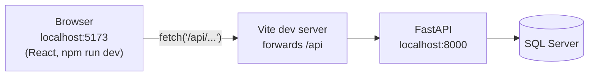

# OmniConnect: Getting Started (Git, Python, React)

A practical guide for developing OmniConnect if you're new to Git and React. Read sections 1–3 once; after that, section 7 (daily routine) is all you need day to day.

**Related:** [`DEVELOPMENT_PLAN.md`](DEVELOPMENT_PLAN.md)

---

## Contents

1. [One-time setup](#1-one-time-setup)
2. [Git in 15 minutes](#2-git-in-15-minutes)
3. [Creating the GitHub repository](#3-creating-the-github-repository)
4. [Python backend basics](#4-python-backend-basics)
5. [React frontend basics](#5-react-frontend-basics)
6. [How the frontend talks to the backend](#6-how-the-frontend-talks-to-the-backend)
7. [Daily routine](#7-daily-routine)
8. ["Help, I broke something"](#8-help-i-broke-something)
9. [Working with Claude](#9-working-with-claude)
10. [Glossary](#10-glossary)

---

## 1. One-time setup

What your PC has today (checked 2026-11-10):

| Tool | Status |
|---|---|
| VS Code | ✅ installed |
| Node.js (for React) | ✅ v24 installed |
| Git | ❌ install |
| Python (via uv) | ❌ install |
| ODBC Driver 18 for SQL Server | ❓ check |

> If `winget` or an installer is blocked on your Refuah PC, ask IT to install the same items.

### 1.1 Install the tools

Open **PowerShell** and run:

```powershell
winget install --id Git.Git -e                 # Git
winget install --id astral-sh.uv -e            # uv: installs Python and packages
winget install --id GitHub.GitHubDesktop -e    # optional: a visual Git app
```

**Close and reopen** PowerShell (and VS Code) so they see the new tools, then:

```powershell
uv python install 3.13       # installs Python 3.13, managed by uv
git --version                # should print a version
uv --version
```

**ODBC Driver 18 for SQL Server:** search "Download ODBC Driver for SQL Server" on Microsoft's site and install the x64 version. Python needs it to connect to SQL Server. (Check first: open "ODBC Data Sources (64-bit)" → Drivers tab. If "ODBC Driver 18 for SQL Server" is listed, you already have it.)

### 1.2 Tell Git who you are (once)

```powershell
git config --global user.name  "Your Name"
git config --global user.email "you@refuahhealth.org"
git config --global init.defaultBranch main
```

### 1.3 VS Code extensions

In VS Code, press `Ctrl+Shift+X` and install:

| Extension | For |
|---|---|
| Python (Microsoft) | Python editing and debugging |
| Ruff | Auto-format and catch Python mistakes |
| ESLint | Catch JavaScript/TypeScript mistakes |
| Prettier | Auto-format React code |
| SQL Server (mssql) | Run SQL from VS Code (optional, since you have SSMS) |
| Markdown Preview Mermaid Support | Shows the diagrams in these docs |
| GitLens | Shows who changed what and when (optional) |

### 1.4 GitHub account

Create an account at github.com, or use the Refuah organization if IT sets one up (decision D6 in the plan). Turn on **two-factor authentication** (Settings → Password and authentication).

---

## 2. Git in 15 minutes

### What Git is

Git saves **snapshots** of your project's files over time. You can see what changed, go back to any earlier version, and work on new things without breaking what works. **GitHub** is a website that stores a copy of your Git project online, so it's backed up, shared and reviewed.

### The five words you need

| Word | Meaning | Analogy |
|---|---|---|
| **Repository (repo)** | The project folder that Git tracks | A binder |
| **Commit** | A saved snapshot with a message | A dated page in the binder: "added login page" |
| **Branch** | A separate line of work | A draft copy you can throw away or merge back |
| **Push / Pull** | Send your commits to GitHub / get others' commits from GitHub | Upload / download |
| **Pull request (PR)** | A request to merge your branch into `main`, with a review page | "Please check my draft before it goes in the binder" |

### How a change travels



### Our branching rule (keep it simple)

- `main` always works. **Never edit `main` directly.**
- For every piece of work, make a branch: `feature/tomorrow-list`, `fix/friday-run`, `docs/readme`.
- When it works, open a pull request, review it (yourself + Claude, later a teammate), and merge.
- Small branches, merged often (1–3 days of work), are much easier than big ones.

### Writing good commit messages

Start with a verb, and say *what* and *why* in under about 70 characters:

- ✅ `Add Friday run covering Saturday and Sunday`
- ✅ `Fix arrival time for Pediatrics late alert (-10 min)`
- ❌ `changes`, `wip`, `fixed stuff`

---

## 3. Creating the GitHub repository

Do this once, at the start of M0.

**Step 1.** Add a `.gitignore` file to `C:\Users\ygarbuz\Projects\OmniConnect` **before** the first commit. This is the list of files Git must never save. Ask Claude to create it; it must include at least:

```gitignore
# Secrets
.env
# Patient data must never be committed
*.csv
*.xlsx
exports/
# Python
.venv/
__pycache__/
# React
node_modules/
dist/
```

**Step 2.** Turn the folder into a Git repo and make the first commit:

```powershell
cd C:\Users\ygarbuz\Projects\OmniConnect
git init
git status                    # check the list: no .env, no data files
git add .
git commit -m "Initial commit: eCW query drafts and project docs"
```

> **Before this first commit:** the chat log and SQL files contain no patient data. Keep it that way. Check `git status` every time before `git add`.

**Step 3.** On github.com: **New repository** → name `OmniConnect` → **Private** → *don't* add a README (you already have files) → Create. GitHub shows a URL like `https://github.com/<org>/OmniConnect.git`.

**Step 4.** Connect and upload:

```powershell
git remote add origin https://github.com/<org>/OmniConnect.git
git push -u origin main
```

The first push opens a browser window to log in to GitHub.

**Step 5.** Protect `main` (GitHub → repo → Settings → Branches → Add rule for `main`): require a pull request before merging, and require the CI checks to pass (once CI exists in M0). Also turn on **Secret scanning** (Settings → Code security).

---

## 4. Python backend basics

### Create the backend (M0, once)

```powershell
cd C:\Users\ygarbuz\Projects\OmniConnect
uv init backend --app --python 3.13
cd backend
uv add "fastapi[standard]" sqlalchemy pyodbc apscheduler python-dotenv
uv add --dev pytest ruff
```

uv creates a private Python environment (`.venv`) just for this project and records the packages in `pyproject.toml` and `uv.lock`. Commit those two files; never commit `.venv`.

### A first endpoint

`backend/app/main.py`:

```python
from fastapi import FastAPI

app = FastAPI(title="OmniConnect")

@app.get("/api/health")
def health():
    return {"status": "ok"}
```

Run it:

```powershell
uv run fastapi dev app/main.py
```

Open http://localhost:8000/api/health to see `{"status":"ok"}`, and http://localhost:8000/docs for automatic, clickable API docs.

### A first test

`backend/tests/test_rules.py`:

```python
from app.rules.arrival import arrival_offset_minutes

def test_peds_late_alert_arrives_10_minutes_early():
    assert arrival_offset_minutes(has_late_alert=True, care_group="PEDS") == -10

def test_adult_late_alert_arrives_15_minutes_early():
    assert arrival_offset_minutes(has_late_alert=True, care_group="ADULT_FAMILY") == -15
```

Run all tests: `uv run pytest`. Format and check code: `uv run ruff format` and `uv run ruff check`.

### Settings and secrets

Connection strings go in `backend/.env` (never committed):

```ini
OMNI_DB_URL=mssql+pyodbc://@YOURSERVER/YourLocalDb?driver=ODBC+Driver+18+for+SQL+Server&trusted_connection=yes&TrustServerCertificate=yes
ALLOWLIST_MODE=true
```

`.env.example` holds the same names with fake values, and **is** committed.

---

## 5. React frontend basics

### What React is

A web page built from **components**: small functions that return what to show. You combine them like building blocks: `<TodayPage>` contains `<CountsBar>` and `<AppointmentTable>`, which contains many `<StatusChip>`s.

### Create the frontend (M0, once)

```powershell
cd C:\Users\ygarbuz\Projects\OmniConnect
npm create vite@latest frontend -- --template react-ts
cd frontend
npm install
npm install @mui/material @emotion/react @emotion/styled @mui/x-data-grid @tanstack/react-query
npm run dev
```

Open http://localhost:5173. While `npm run dev` is running, the page updates every time you save a file.

### The 3 ideas you need

**1. Components and props.** Props are inputs, like function arguments:

```tsx
// src/components/StatusChip.tsx
import Chip from "@mui/material/Chip";

type Props = { status: string };

export function StatusChip({ status }: Props) {
  const color = status.startsWith("CONF") ? "success"
              : status.startsWith("CANC") ? "error"
              : "default";
  return <Chip label={status} color={color} size="small" />;
}

// used elsewhere:  <StatusChip status="CONFPHONE" />
```

**2. State** is a value that changes on screen, like a search box:

```tsx
import { useState } from "react";
import TextField from "@mui/material/TextField";

export function SearchBox() {
  const [text, setText] = useState("");        // current value + a function to change it
  return <TextField label="Search patient" value={text}
                    onChange={(e) => setText(e.target.value)} />;
}
```

When `setText` runs, React redraws the component with the new value.

**3. Loading data** from the backend, with TanStack Query:

```tsx
import { useQuery } from "@tanstack/react-query";

export function HealthBadge() {
  const { data, isLoading, error } = useQuery({
    queryKey: ["health"],
    queryFn: () => fetch("/api/health").then((r) => r.json()),
  });
  if (isLoading) return <span>Checking…</span>;
  if (error) return <span>Backend not reachable</span>;
  return <span>Backend: {data.status}</span>;
}
```

> `.tsx` = TypeScript + HTML-like markup (JSX). If TypeScript underlines something in red, hover over it; it's usually a typo or a missing field, caught before you run anything.

### Where things go

| Folder | Put here |
|---|---|
| `src/pages/` | One file per screen: `TodayPage.tsx`, `SearchPage.tsx`, `VisitTimelinePage.tsx` |
| `src/components/` | Reusable pieces: `StatusChip.tsx`, `Timeline.tsx` |
| `src/api/` | Functions that call the backend: `getAppointments()` |

---

## 6. How the frontend talks to the backend



During development, run **both** in two terminals (VS Code: Terminal → Split):

| Terminal 1 (backend) | Terminal 2 (frontend) |
|---|---|
| `cd backend` | `cd frontend` |
| `uv run fastapi dev app/main.py` | `npm run dev` |

Tell Vite to forward `/api` to FastAPI, in `frontend/vite.config.ts`:

```ts
import { defineConfig } from "vite";
import react from "@vitejs/plugin-react";

export default defineConfig({
  plugins: [react()],
  server: { proxy: { "/api": "http://localhost:8000" } },
});
```

---

## 7. Daily routine

```powershell
# 1. Start of the day: get the latest main
git switch main
git pull

# 2. Start a new piece of work on its own branch
git switch -c feature/short-description

# 3. Work... save often... run tests
cd backend; uv run pytest; cd ..

# 4. Save a snapshot (repeat as often as you like)
git status                       # what changed? any data files? any .env?
git add .
git commit -m "Add tomorrow's list endpoint"

# 5. Upload the branch
git push -u origin feature/short-description    # later pushes: just  git push
```

**6.** On GitHub, click **Compare & pull request**. Describe what changed and how you tested it. Wait for CI (the green check). Review the "Files changed" tab yourself. Then click **Merge**.

```powershell
# 7. Back to main, clean up
git switch main
git pull
git branch -d feature/short-description
```

Prefer clicking? **GitHub Desktop** and VS Code's **Source Control** panel (`Ctrl+Shift+G`) do the same steps with buttons.

---

## 8. "Help, I broke something"

| Situation | Command |
|---|---|
| Undo my unsaved edits to one file (back to the last commit) | `git restore path\to\file` |
| I ran `git add` on a file by mistake | `git restore --staged path\to\file` |
| Fix the message of my last commit (**not pushed yet**) | `git commit --amend -m "Better message"` |
| See what I changed | `git diff` (unstaged) · `git diff --staged` (staged) |
| See history | `git log --oneline -15` |
| Throw away a whole experiment branch | `git switch main`, then `git branch -D feature/experiment` |
| Pull says "conflict" | Open the file in VS Code: it shows both versions with *Accept* buttons. Choose, save, `git add`, `git commit`. Or ask Claude. |
| **I committed patient data or a password** | **Stop. Don't push** (or if already pushed, don't keep working). Tell IT/compliance and rotate the password. A new commit that deletes it is **not** enough; Git keeps history. |

Golden rule: if unsure, **don't run commands that say `--force`, `reset --hard` or `clean`**. Ask first.

---

## 9. Working with Claude

Good ways to use Claude on this project:

- **"Explain this file / this error to me like I'm new to React."**
- **"Build the next step of milestone M1 in DEVELOPMENT_PLAN.md"**, then read what it did, and ask why for anything unclear.
- **"Write tests for `is_contact_allowed` using the Shabbat cases in db/ecw/PLAN.md."**
- **"Review my branch before I open the pull request"** (the `/code-review` command).
- **"Did I commit anything that looks like PHI or a secret?"**

Habits that keep it effective:
- Work on a branch, so anything Claude does is easy to review or throw away.
- Keep the docs (`PLAN.md`, `DEVELOPMENT_PLAN.md`, the chat log) updated; they let a new session pick up where you left off.
- Never paste real patient data into a chat. Describe it, or use fake examples.

---

## 10. Glossary

| Term | Meaning |
|---|---|
| **API** | A set of URLs the dashboard calls to get or send data (`/api/appointments`) |
| **Endpoint** | One of those URLs |
| **Webhook** | A URL *the call/SMS provider* calls to tell us something happened (reply, delivery) |
| **JSON** | The text format the API uses: `{"status": "ok"}` |
| **Component** | A React building block (a function that returns UI) |
| **Props / State** | A component's inputs / its changing values |
| **CI** | GitHub automatically runs tests on every push (GitHub Actions) |
| **Migration** | A versioned script that creates or changes database tables (Alembic) |
| **Environment variable / `.env`** | Settings and secrets kept outside the code |
| **Dependency / package** | Code from others that we install (`fastapi`, `react`) |
| **`localhost`** | Your own PC; `localhost:8000` = something running on your PC on port 8000 |
| **Shadow mode** | The system runs fully but contacts nobody; we compare its output with reality |
| **Allowlist mode** | The system can only contact approved test phone numbers |
