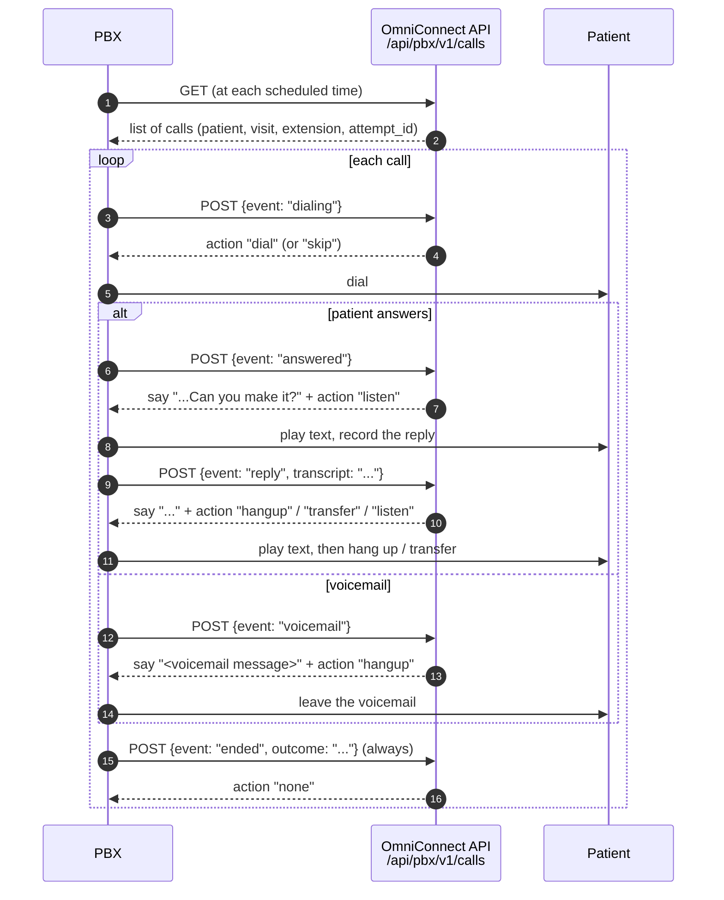

# OmniConnect ↔ PBX Integration: Appointment Confirmation Calls

**API version:** v1, **draft 0.3 for review** (2026-11-23)
**OmniConnect contact:** ygarbuz@refuahhealth.org
**Audience:** the PBX / telephony team

This document describes the data the PBX will **receive** from OmniConnect, what it must **send back**, and when. Field names and flows are a proposal: please review them, answer the questions in [section 10](#10-questions-for-the-pbx-team), and send corrections. Nothing is final until both teams agree.

**In short:** there is **one address**, `/api/pbx/v1/calls`.
- **GET** returns the calls to place now.
- **POST** reports everything that happens on a call: about to dial, answered, the patient's reply, silence, voicemail, call ended. Every POST answer tells the PBX what to say and what to do next.

---

## Contents
1. [Who does what](#1-who-does-what)
2. [Call flow overview](#2-call-flow-overview)
3. [Conventions](#3-conventions)
4. [The endpoint: GET and POST /calls](#4-the-endpoint-get-and-post-calls)
5. [Example conversations](#5-example-conversations)
6. [Errors, timeouts and the fallback rule](#6-errors-timeouts-and-the-fallback-rule)
7. [Rules the PBX must follow](#7-rules-the-pbx-must-follow)
8. [Security and patient data](#8-security-and-patient-data)
9. [Testing](#9-testing)
10. [Questions for the PBX team](#10-questions-for-the-pbx-team)
11. [Change log](#11-change-log)

---

## 1. Who does what

**OmniConnect leads the conversation; the PBX carries it out.** The PBX never needs to decide what to say. Every sentence, every next step and every transfer extension comes from the API. Message wording and business rules can then change without any change on the PBX side.

| PBX | OmniConnect API |
|---|---|
| Runs the schedule: asks for calls at the agreed times | Decides **who** to call and **when it's allowed** (business hours, Shabbat and Jewish holidays, retries) |
| Dials the patient | Supplies the patient, visit and extension data |
| Detects answered / voicemail / busy / no answer | Writes every sentence the patient hears (English or Spanish) |
| Plays the text it receives (text-to-speech) | Understands the patient's reply (confirm / cancel / reschedule / unclear) |
| Records the patient's spoken reply and converts it to text (speech-to-text)\* | Decides the next step: continue, hang up or transfer |
| Transfers to the extension the API gives | Updates the appointment in eCW and keeps the audit trail |
| Reports the end of every attempt | |

\* Speech-to-text on the PBX side is the preferred option. If that isn't possible, see question Q3.

---

## 2. Call flow overview



In words:
1. **At each scheduled time** (for example 9:00 AM, 2:00 PM and 6:00 PM, see Q7), the PBX sends a **GET** for the calls that are due.
2. **Before each dial,** the PBX POSTs `dialing`. The API answers `dial`, or `skip` if the appointment was cancelled in the meantime or the allowed calling time has ended.
3. **During the call,** the PBX POSTs each event (answered, the patient's reply, silence, voicemail). Each answer says what to play and what to do next.
4. **After every attempt,** including skipped ones, the PBX POSTs `ended` with the outcome.

---

## 3. Conventions

| Topic | Rule |
|---|---|
| **Address** | Test: `https://<test-host>/api/pbx/v1/calls` · Production: `https://<prod-host>/api/pbx/v1/calls` *(hosts to be provided)* |
| **Protocol** | HTTPS only (TLS 1.2+). JSON bodies, `Content-Type: application/json`, UTF-8. |
| **Authentication** | Header `X-API-Key: <key>` on every request. Separate keys for test and production, sent through a secure channel, never by email. Requests are also limited to the PBX server's IP addresses. |
| **Date-times** | ISO 8601 with the UTC offset, in clinic local time (America/New_York): `2026-11-17T09:30:00-05:00` |
| **Phone numbers** | E.164 format: `+18455550100` |
| **IDs** | `attempt_id` identifies **one dial attempt** and is sent in every POST about it. `call_id` identifies the call across its retries. |
| **Unknown fields** | Ignore fields you don't recognize. We may add new fields in v1 without notice; we will never remove or rename one without a new version (`/v2`). |
| **Languages** | `en-US` or `es-US`, given per call. |

---

## 4. The endpoint: GET and POST /calls

### 4.1 GET /calls: get the calls to place now

**When:** at each scheduled time. Call it repeatedly until `calls` is empty, since each request returns at most `limit` calls.

**What happens on our side:** each call returned is **reserved for the PBX**, so it won't be returned again. The PBX then owns it until it POSTs `ended` for that `attempt_id`.

**Query parameters**

| Name | Required | Description |
|---|---|---|
| `limit` | no | Max calls to return (default 50, max 200) |

**Response `200`**
```json
{
  "batch_id": "2026-11-16T09:00-day-prior",
  "generated_at": "2026-11-16T08:59:58-05:00",
  "calls": [
    {
      "attempt_id": "a-7f3c2e10",
      "call_id": 5001,
      "attempt_number": 1,
      "call_type": "day_prior_confirmation",
      "phone": "+18455550100",
      "language": "en-US",
      "operator_extension": "1100",
      "do_not_call_after": "2026-11-16T20:00:00-05:00",
      "patients": [
        {
          "patient_name": "Test Patient",
          "mrn": "TEST000001",
          "appointments": [
            {
              "appointment_id": 1001,
              "visit_datetime": "2026-11-17T09:30:00-05:00",
              "arrival_datetime": "2026-11-17T09:15:00-05:00",
              "facility": "Refuah Health Twin",
              "facility_address": "5 Twin Ave, Spring Valley, NY 10977",
              "provider": "Dr. Example"
            }
          ]
        }
      ]
    }
  ]
}
```

**Fields**

| Field | Type | Description |
|---|---|---|
| `attempt_id` | string | ID of this dial attempt. Send it in every POST about this attempt. |
| `call_id` | integer | The same call across retries (the attempt 2 call keeps the same `call_id`). |
| `attempt_number` | integer | 1 for the first try, 2 and 3 for retries. |
| `call_type` | string | `day_prior_confirmation` (later also `same_day_reminder`). |
| `phone` | string | Number to dial (E.164). **Dial only this number.** |
| `language` | string | Language of the text the API will send (`en-US` / `es-US`). Use a matching text-to-speech voice. |
| `operator_extension` | string | Extension to transfer to **if the API cannot be reached** during the call (see §6). In normal operation the API also sends the transfer extension in its answers. |
| `do_not_call_after` | date-time | **Do not start dialing after this time.** For example Friday 12:00 PM before Shabbat, or the end of calling hours. |
| `patients[]` | array | One or more patients on this call. A family can be grouped into one call. |
| `patients[].patient_name` | string | Patient's full name. |
| `patients[].mrn` | string | Refuah medical record number. |
| `appointments[]` | array | The patient's appointments covered by this call (usually one; one patient can have two on the same day). |
| `appointment_id` | integer | eCW appointment ID. |
| `visit_datetime` | date-time | Scheduled visit time. |
| `arrival_datetime` | date-time | Time the patient is asked to arrive (earlier than the visit for some patients). |
| `facility` / `facility_address` | string | Site name and address. |
| `provider` | string | Provider name as it should be read out. |

> The patient and visit fields are given for screen display and logging on the PBX side. **The PBX doesn't need to build any sentences from them:** all spoken text comes from the POST answers (§4.2).

**Empty response:** `{"batch_id": "...", "calls": []}`. This is normal outside calling hours, on Shabbat and holidays, or when nothing is due.

---

### 4.2 POST /calls: report what happened

**When:** for every step of every attempt, from just before dialing to the end. **The answer always has the same shape** (`say` + `action`) and tells the PBX what to do next.

#### Request: fields in every POST

```json
{
  "attempt_id": "a-7f3c2e10",
  "sequence": 3,
  "event": "reply",
  "occurred_at": "2026-11-16T09:04:31-05:00",
  "transcript": "yeah we'll be there",
  "transcript_confidence": 0.93,
  "ai_intent": "confirm"
}
```

| Field | Required | Description |
|---|---|---|
| `attempt_id` | yes | From the GET response. |
| `sequence` | yes | 1, 2, 3… increasing within the attempt (`dialing` is 1). If the same `attempt_id` + `sequence` is sent twice (a network retry), the API returns the same answer again and doesn't process it twice. |
| `event` | yes | What happened. See the event table below. |
| `occurred_at` | yes | When it happened. |
| *(event fields)* | per event | Extra fields some events need. See the event table below. |

#### Events

| `event` | Send when | Extra fields | Usual answer |
|---|---|---|---|
| `dialing` | Right before dialing | none | `dial` or `skip` |
| `answered` | A person answered | none | opening text + `listen` |
| `voicemail` | Voicemail / answering machine detected, after the beep | none | voicemail text + `hangup` |
| `reply` | The patient spoke after a `listen` | `transcript` **(required)**, `transcript_confidence` (optional, 0–1), `ai_intent` (optional: Grok's guess, one of `confirm`, `cancel`, `reschedule`, `unclear`; the API uses it only when the words themselves are unclear) | next text + `listen` / `hangup` / `transfer` |
| `no_input` | After a `listen`, silence until the timeout | none | the question again, or `transfer` |
| `hangup_by_patient` | The patient hung up during the conversation | none | `none` |
| `ended` | The attempt is over: completed, transferred, voicemail, no answer, busy, failed or skipped. **Always the last POST.** | see [`ended` fields](#ended-fields) | `none` |

#### <a id="ended-fields"></a>`ended` fields

```json
{
  "attempt_id": "a-7f3c2e10",
  "sequence": 5,
  "event": "ended",
  "occurred_at": "2026-11-16T09:06:40-05:00",
  "outcome": "transferred",
  "dial_started_at": "2026-11-16T09:04:02-05:00",
  "answered_at": "2026-11-16T09:04:09-05:00",
  "transfer": {
    "extension": "1100",
    "queue_wait_seconds": 74,
    "answered_by_extension": "1123",
    "result": "answered"
  },
  "recording_id": "rec-55821",
  "detail": null
}
```

| Field | Required | Description |
|---|---|---|
| `outcome` | yes | See the outcome table below. |
| `dial_started_at` | if dialed | When dialing began. |
| `answered_at` | if answered | When a person or voicemail answered. |
| `transfer` | if transferred | `extension`, `queue_wait_seconds`, `answered_by_extension` (if known), and `result`: `answered` or `abandoned` (the patient hung up in the queue). |
| `recording_id` | no | PBX recording reference, if calls are recorded. |
| `detail` | no | Extra information: for `failed`, the reason or SIP code; for `not_dialed`, the reason. |

**Outcomes**

| `outcome` | Meaning |
|---|---|
| `completed` | Conversation finished in the call (for example the patient confirmed and the call was hung up). |
| `transferred` | The call was transferred to an extension. |
| `voicemail` | A voicemail was left. |
| `no_answer` | Rang with no answer and no voicemail. |
| `busy` | Line busy. |
| `failed` | Couldn't connect (invalid number, network error…). Put the reason in `detail`. |
| `hangup_early` | The patient hung up before the conversation finished. |
| `not_dialed` | Not dialed: the API answered `skip`, the `dialing` POST failed, or `do_not_call_after` had passed. Reason in `detail`. |

> OmniConnect turns these outcomes into eCW statuses (confirmed, voicemail left, unreachable, transferred) and decides whether to retry. The PBX doesn't need to know the eCW status codes.

#### Response `200`: the same shape for every event

```json
{
  "say": "Can you make it to your appointment? Please say confirm, cancel, or reschedule.",
  "language": "en-US",
  "action": "listen",
  "listen": { "max_silence_seconds": 5, "max_speech_seconds": 15,
              "hints": ["confirm", "cancel", "reschedule", "yes", "no"] }
}
```
```json
{
  "say": "Please hold while I transfer you to a staff member.",
  "language": "en-US",
  "action": "transfer",
  "transfer_to": "1100",
  "transfer_note": "Wants to cancel: Test Patient, Mon 11/17 9:30 AM, Dr. Example"
}
```
```json
{ "say": "", "action": "skip", "reason": "appointment_cancelled" }
```

| Field | Description |
|---|---|
| `say` | Text to play with text-to-speech. May be empty. |
| `language` | Voice language for `say`. |
| `action` | What to do **after** playing `say`. See the action table below. |
| `listen` | With `listen`: recording limits, plus optional `hints` (expected words that can improve speech recognition). |
| `transfer_to` | With `transfer`: the extension. |
| `transfer_note` | With `transfer`: a short reason for the operator, if the PBX can show or whisper it (see Q5). |
| `reason` | With `skip`: `appointment_cancelled`, `already_confirmed`, `outside_calling_hours`, `no_contact_day` or `superseded`. |

**Actions**

| `action` | PBX does | Answers to |
|---|---|---|
| `dial` | Dial the call's `phone` now. | `dialing` |
| `skip` | **Don't dial.** POST `ended` with `outcome: "not_dialed"`. | `dialing` |
| `listen` | Play `say`, record the reply, then POST `reply` (with the transcript) or `no_input`. | conversation events |
| `hangup` | Play `say`, then end the call, then POST `ended`. | conversation events |
| `transfer` | Play `say`, then transfer to `transfer_to`, then POST `ended`. | conversation events |
| `none` | Nothing more to do. | `hangup_by_patient`, `ended` |

**Response time:** the API targets an answer within **1.5 seconds**. During a live call the PBX should wait **up to 4 seconds**; after that, apply the fallback rule (§6).

---

## 5. Example conversations

Wording below is illustrative; the actual text always comes from the API. Every attempt starts with `dialing` → `dial` and ends with an `ended` POST; those two steps are left out below except in G.

**A. The patient confirms**
| # | PBX POSTs | API answers |
|---|---|---|
| 2 | `answered` | say: *"Hello, this is Refuah Health Center calling about Test Patient's appointment with Dr. Example on Monday, November 17 at 9:30 AM, at Refuah Health Twin, 5 Twin Avenue, Spring Valley. Can you make it? Please say confirm, cancel, or reschedule."* · `listen` |
| 3 | `reply` "yes, we'll be there" | say: *"Thank you, the appointment is confirmed. Goodbye."* · `hangup` |
| 4 | `ended`, outcome `completed` | `none` |

**B. The patient wants to cancel.** The API reads the appointment back and offers two choices.
| # | PBX POSTs | API answers |
|---|---|---|
| 2 | `answered` | (opening, as above) · `listen` |
| 3 | `reply` "I need to cancel" | say: *"You'd like to cancel your appointment on Monday, November 17 at 9:30 AM. Should we cancel it now, or only once you have a new appointment? Please say cancel now, or new appointment."* · `listen`, hints `cancel now`, `new appointment`, `keep it` |

Then one of:

| # | PBX POSTs | API answers |
|---|---|---|
| **B1** 4 | `reply` "cancel it now" | say: *"Just to make sure: you want to cancel your appointment on Monday, November 17 at 9:30 AM. Is that right? Please say yes or no."* · `listen`, hints `yes`, `no` |
| 5 | `reply` "yes" | say: *"Your appointment on Monday, November 17 at 9:30 AM has been cancelled. Thank you for letting us know. Goodbye."* · `hangup`. OmniConnect cancels the visit in eCW. If the answer is "no" or unclear: `transfer`, and the visit is **not** changed. |
| 6 | `ended`, outcome `completed` | `none` |
| **B2** 4 | `reply` "only if I get a new appointment" | say: *"Please hold while I transfer you to a staff member."* · `transfer` to `1100`, `transfer_note` *"Cancel once a new appointment is booked: …"*. The visit is **not** changed. |
| 5 | `ended`, outcome `transferred` | `none` |
| **B3** 4 | `reply` "never mind, don't cancel" | say: *"Okay, we won't cancel it. Can you make it? …"* · `listen` (back to the main question) |

If the answer to the choice is unclear, or the call covers several appointments, the API transfers to an operator.

**C. Reschedule → transfer**
| # | PBX POSTs | API answers |
|---|---|---|
| 3 | `reply` "can I come another day?" | say: *"Please hold while I transfer you to a staff member."* · `transfer` to `1100`, `transfer_note` *"Wants to reschedule: …"* |

**D. Unclear answer → transfer**
| # | PBX POSTs | API answers |
|---|---|---|
| 3 | `reply` "who is this?" | say: *"Please hold while I transfer you to a staff member."* · `transfer` |

**E. Silence**
| # | PBX POSTs | API answers |
|---|---|---|
| 3 | `no_input` | say: *"Sorry, I didn't hear you."* + the question again · `listen` |
| 4 | `no_input` | say: *"Please hold while I transfer you to a staff member."* · `transfer` |

**F. Voicemail**
| # | PBX POSTs | API answers |
|---|---|---|
| 2 | `voicemail` | say: *(a general message with no patient name or visit details: someone else may hear it)* · `hangup` |
| 3 | `ended`, outcome `voicemail` | `none` |

**G. Appointment cancelled before the call**
| # | PBX POSTs | API answers |
|---|---|---|
| 1 | `dialing` | `skip`, reason `appointment_cancelled` |
| 2 | `ended`, outcome `not_dialed`, detail `appointment_cancelled` | `none` |

**H. No answer / busy:** `dialing` → `dial`, then `ended` with outcome `no_answer` or `busy`. The API will offer a retry at a later GET, with a new `attempt_id` and the same `call_id`.

---

## 6. Errors, timeouts and the fallback rule

**HTTP status codes**

| Status | Meaning | PBX action |
|---|---|---|
| `200` | OK | Do what `action` says |
| `400` / `422` | Request not valid (missing field, wrong format, e.g. `reply` without `transcript`) | Don't retry; log it and tell us. The body explains: `{"error": "...", "detail": "..."}` |
| `401` | Missing or wrong API key | Don't retry; check the configuration |
| `404` | Unknown `attempt_id` | Don't retry |
| `409` | Attempt already ended (an `ended` was already received) | Don't retry |
| `429` | Too many requests | Wait the number of seconds in the `Retry-After` header, then retry |
| `5xx` / timeout | Problem on our side | See below, by request |

**What to do when a request fails, by request:**

| Request | If it fails or times out |
|---|---|
| GET | Try again at the next scheduled time. |
| POST `dialing` | **Don't dial.** POST `ended` with `not_dialed`, detail `check_failed`; the call will be offered again later. |
| POST during a live call (`answered`, `reply`, `no_input`, `voicemail`) | Apply the **fallback rule** below. |
| POST `ended` | Retry with backoff (after 1, 5 and 30 minutes). Until it arrives, the call can't be retried or closed. |

**The fallback rule (during a live call):** if a POST fails, or doesn't answer within **4 seconds**, the patient must not be left in silence or cut off:
1. Play a fixed phrase: *"Please hold while I transfer you to a staff member."* (A Spanish version is needed too.)
2. Transfer to the call's `operator_extension`.
3. POST `ended` as usual, with `outcome: "transferred"` and `detail: "api_fallback"`.

---

## 7. Rules the PBX must follow

1. **Dial only** numbers received from the GET, and only once per `attempt_id`.
2. **POST `dialing` before every dial,** and dial only if the answer is `dial`.
3. **Never start a call after `do_not_call_after`.** This enforces the Shabbat/holiday rule and calling hours.
4. **Play only the text the API sends** (or the fixed fallback phrase).
5. **POST `ended` for every attempt** received, dialed or not. It is always the last POST.
6. **Apply the fallback rule** on any API failure during a live call.
7. **Don't store patient data longer than needed,** and keep it out of general logs (see §8).

---

## 8. Security and patient data

These requests contain **protected health information (PHI)**: names, MRNs, phone numbers, appointment details and the patient's spoken replies.

- HTTPS only, with an API key per environment and IP allowlisting on our side.
- **Store keys in the PBX's secure configuration,** never in scripts, tickets or email.
- **Logging:** log `attempt_id`, the event, the outcome and timestamps. **Don't log** names, phone numbers, MRNs or transcripts in general-purpose logs.
- **Recordings and transcripts:** if the PBX stores recordings, they are PHI. Agree on retention and access with Refuah compliance.
- **Speech-to-text and text-to-speech:** if these run on a cloud service, that service needs a **BAA** with Refuah before real patient calls.

---

## 9. Testing

1. **Test environment first.** It returns only fake patients with **test phone numbers we agree on** (staff phones). Real patient numbers can't be returned in test.
2. We'll share a **list of test scenarios** (section 5, plus failure cases: API down, a slow answer, a duplicate POST) to run together.
3. **Interactive documentation** of the test API will be available at `https://<test-host>/docs`, where every request can be tried in a browser.
4. Production is switched on only after all scenarios pass, starting with a small pilot group.

---

## 10. Questions for the PBX team

| # | Question |
|---|---|
| Q1 | Which PBX platform and version? |
| Q2 | Can the PBX call an HTTPS API **during a live call**, wait for the JSON answer, and act on it (play text, record, transfer)? |
| Q3 | Can the PBX do **speech-to-text** (English and Spanish)? With which engine, and is it on-premises or cloud (BAA)? If not, can it send us the recorded audio instead (for example as a file upload with the `reply` event)? |
| Q4 | Can it play **text-to-speech** in English and Spanish? Which voices? |
| Q5 | Can it pass a short note to the operator on transfer (screen pop or whisper, `transfer_note`)? |
| Q6 | Can it detect voicemail reliably and wait for the beep before playing? |
| Q7 | At what times will it send the GET, and how many calls can it make at once? |
| Q8 | What caller ID will patients see? |
| Q9 | Can it report queue wait time, abandoned transfers and the answering extension in `ended`? |
| Q10 | Are calls recorded? If yes, where, and for how long? |
| Q11 | What is the maximum time it can wait for an API answer during a call before the patient hears silence? Can it play a short tone while waiting? |
| Q12 | Which IP addresses will call the API (for the allowlist)? |

---

## 11. Change log

| Version | Date | Change |
|---|---|---|
| 0.3 | 2026-11-24 | New optional `ai_intent` on `reply`: the PBX's Grok guess, used only for unclear replies to the first question. Cancel now asks once more ("Is that right?") before cancelling; no or unclear → transfer. Earlier in 0.3 (2026-11-23): cancel offers two choices: cancel now (the visit is cancelled) or cancel only once a new appointment is booked (transfer). Reschedule goes straight to an operator. Voicemail has no patient details. Example wording matches the API. |
| 0.2 | 2026-11-15 | One address, `/api/pbx/v1/calls`, with GET and POST. The pre-dial check is now the `dialing` event, and the final result is the `ended` event. |
| 0.1 | 2026-11-15 | First draft for review (four separate endpoints) |
